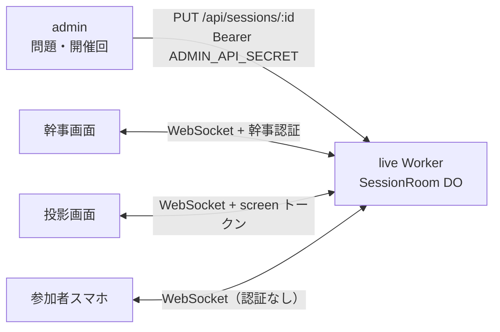

# 幕の内（Makunouchi）

結婚式の余興向け 4 択クイズアプリです。幹事が手元の画面で進行し、会場の投影画面に問題と結果を出し、参加者がスマホで回答します。問題と開催回の準備は管理画面（admin）で行い、当日の接続と進行はライブアプリ（live）が受け持ちます。

## 全体像

| アプリ | 役割 | 主な技術 |
| --- | --- | --- |
| [`apps/live`](apps/live/README.md) | 当日の進行。ゲスト・幹事・投影画面の WebSocket、開催回の状態 | Cloudflare Workers + Durable Object、Hono、React、wrangler |
| [`apps/admin`](apps/admin/README.md) | 問題の CRUD、開催回の作成、幹事 ID/PASS の発行。live への登録。結果の取り込み・保存はしない | Rails 8.1、Cloud Run、Neon、R2 |

データの流れは次のとおりです。



認証は次の 4 種類です。

- admin → live: `Authorization: Bearer <ADMIN_API_SECRET>`（開催回の作成。本番は 32 文字以上）
- 幹事画面: 幹事 ID/パスワードでログインし、Worker が HMAC トークンを返す。緊急時はトークン付き URL も使える
- 投影画面: `HMAC-SHA256(ADMIN_API_SECRET, "screen:" + sessionId)`（hex）のトークン
- ゲスト: 認証なし。ニックネームで参加し、再接続用に `playerToken` を端末に保存する

当日のゲスト通信は live だけで完結し、Rails（admin）には届きません。1 開催回あたり最大 120 人程度を想定し、負荷試験は 150 接続です。

## リポジトリ構成

```
apps/live/          当日進行（Workers + React）
apps/admin/         管理画面（Rails）
docs/requirements/  要件（企画書・シナリオ・UI。入口は docs/requirements/README.md）
docs/superpowers/   設計書・実装計画
docs/deploy/        初回デプロイと CI デプロイの手順
```

## ローカル開発

各アプリの README を入口にしてください。

- live: [apps/live/README.md](apps/live/README.md)（Node 22 以上、pnpm）
- admin: [apps/admin/README.md](apps/admin/README.md)（Ruby 4.0.6 / Rails 8.1、PostgreSQL）

ルートは pnpm ワークスペースです。`apps/admin` には `package.json` を置かず、Rails だけで扱います。

## デプロイ

初回のクラウド準備・secret・CI は README から切り出しています。

- admin（Cloud Run / Neon / R2 / Workload Identity）: [docs/deploy/admin.md](docs/deploy/admin.md)
- live（Cloudflare Workers / secret / GitHub Actions）: [docs/deploy/live.md](docs/deploy/live.md)

本番への反映は `release` ワークフローでタグ（`app-YYYYMMDD-HHMM` / `live-YYYYMMDD-HHMM`）を切ってからデプロイします。`main` への push だけではデプロイしません。詳細は上記の各文書の GitHub Actions の節を見てください。


本番のクイズ進行中は live をデプロイしないでください。全員の WebSocket が切れます。


## セキュリティ

脆弱性の報告は [SECURITY.md](SECURITY.md) の手順に従ってください。公開の Issue に詳細を書かないでください。
