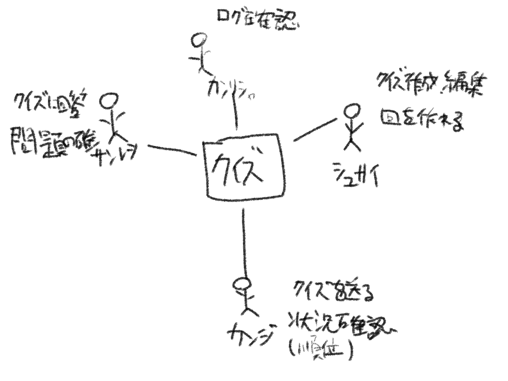
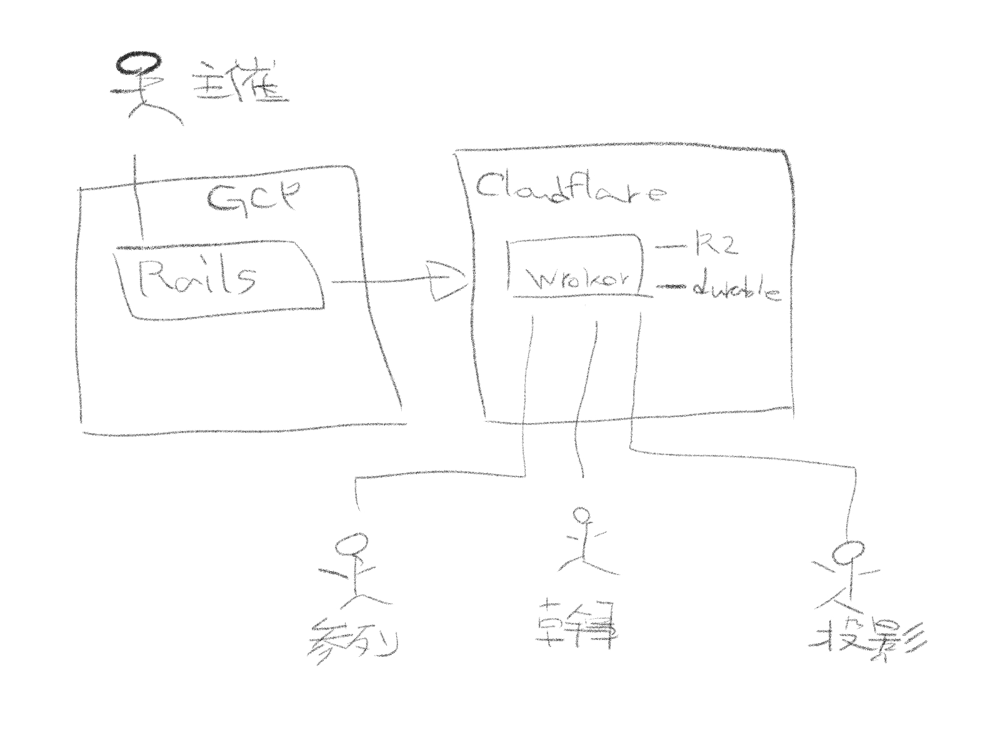
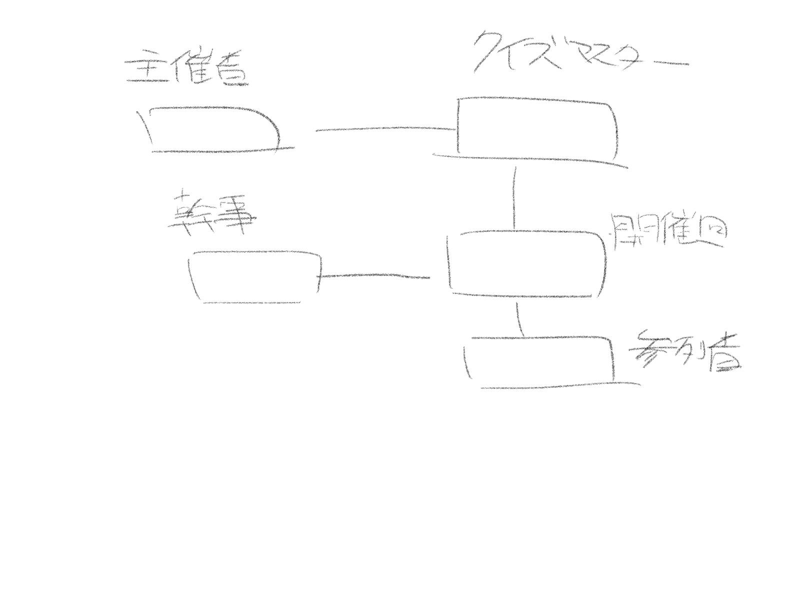
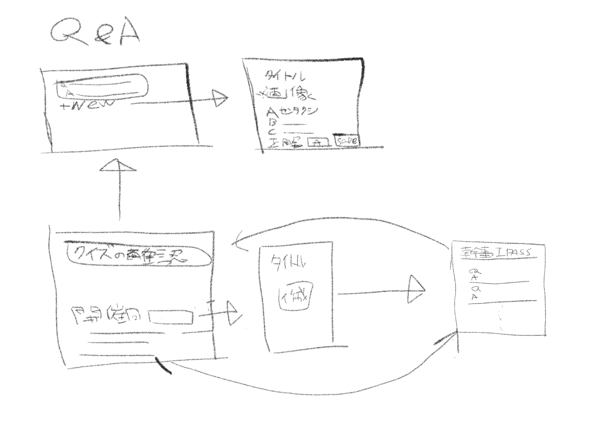
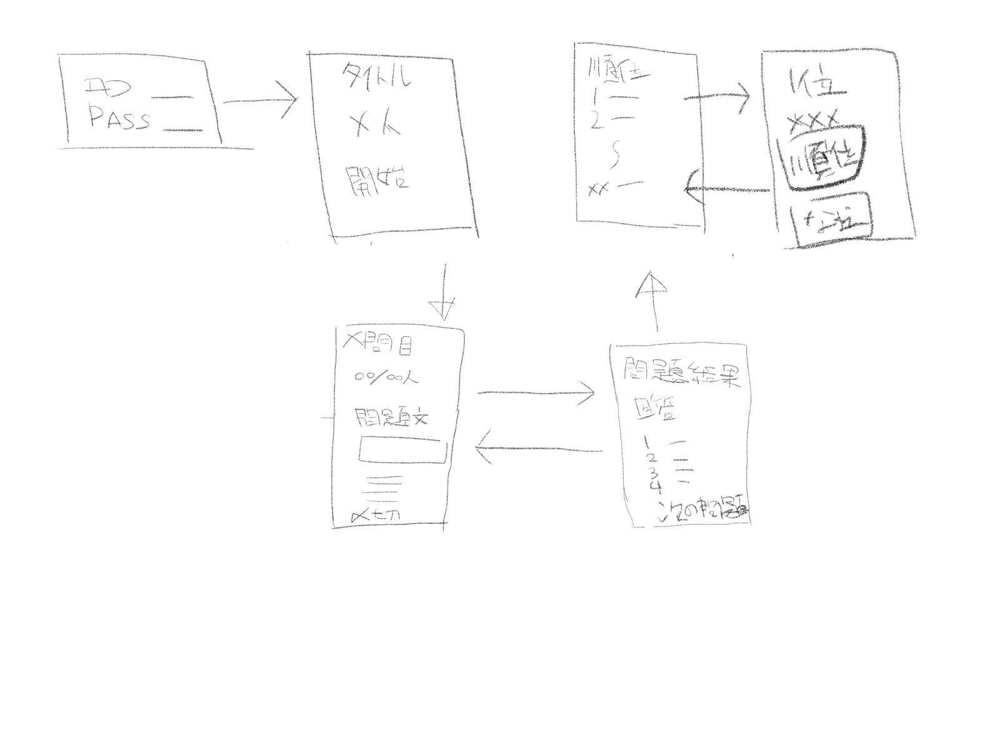
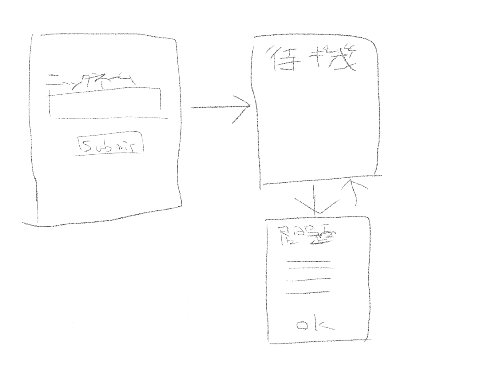

# 要件資料（正）

このディレクトリの資料を、このプロジェクトの要件の正とする。`docs/superpowers/specs/2026-10-25-wedding-quiz-design.md` はこれに合わせて改訂した設計書で、食い違ったときはこちらを優先する。

## 文書

| ファイル | 内容 |
|---|---|
| [企画書.md](企画書.md) | 目的（why）、作るもの（what）、体制と期限（how）、その他やりたいこと |
| [行動シナリオ.md](行動シナリオ.md) | 登場人物（システム管理者・主催者・幹事・参列者）と、それぞれができること |
| [UI作成.md](UI作成.md) | 管理画面・幹事画面・参列者画面の画面一覧と、各画面の表示・入力・操作 |

## 手書きスケッチ

### b1: ユースケース図

カンリシャ（ログ確認）、シュサイ（クイズ作成・編集、回を作れる）、サンレツ（クイズに回答、問題の確認）、カンジ（クイズを送る、順位などの状況確認）。

### b2: システム構成図

主催者は GCP 上の Rails を使う。Rails から Cloudflare の Worker（R2 と Durable Object を利用）へ問題を送る。参列者・幹事・投影の 3 者が Worker につながる。

### b3: データモデル

主催者 ― クイズマスター ― 開催回 ― 参列者。幹事は開催回に結びつく。

### b4: 管理画面の画面遷移

Q&A 一覧（+new）→ Q&A 作成（タイトル、画像、選択肢、正解、Save）。トップ（クイズの編集、開催回一覧）→ 開催回作成（タイトル、作成）→ 開催回詳細（幹事 ID/PASS、Q&A 一覧）→ トップ。

### b5: 幹事画面の画面遷移

ログイン（ID/PASS）→ 待機（タイトル、参加人数、開始）→ 問題（何問目、回答人数、問題文、画像、選択肢、締め切り）⇄ 問題結果（選択肢ごとの回答、次の問題）→ 順位一覧 ⇄ 順位詳細（順位、名前、それぞれを投影するボタン）。

### b6: 参列者画面の画面遷移

ニックネーム入力（Submit）→ 待機 ⇄ 問題（選択肢、OK）。

